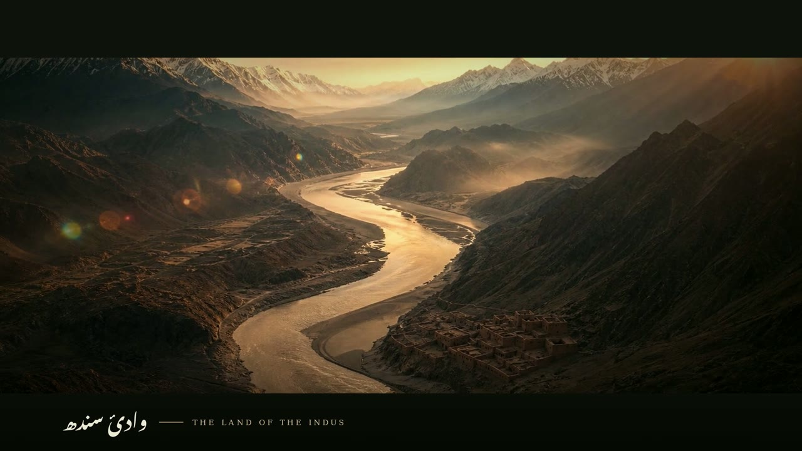

# تاریخِ پاکستان — A History of Pakistan (Urdu documentary)

A 5-minute cinematic documentary on the history of Pakistan, narrated in Urdu.
Produced with AI-generated visuals, a synthesized orchestral score, and Urdu
(Nastaliq) typography rendered with HarfBuzz + FreeType.

## Download

**➡ [A_History_of_Pakistan_Urdu.mp4](https://github.com/arbabkhan007/Sora-Video/raw/arena/ace609de-sora-video/docs/urdu-documentary/A_History_of_Pakistan_Urdu.mp4)** (79 MB)

GitHub page (with a Download button): [docs/urdu-documentary/A_History_of_Pakistan_Urdu.mp4](https://github.com/arbabkhan007/Sora-Video/blob/arena/ace609de-sora-video/docs/urdu-documentary/A_History_of_Pakistan_Urdu.mp4)

| | |
|---|---|
| Runtime | 5:05 |
| Frame | 1920 × 1080, 30 fps, H.264 (High@4.1), 2.39:1 letterbox |
| Audio | AAC 192 kbps, 48 kHz stereo — Urdu narration + score |
| Size | 79 MB |

## Chapters

| # | Time | Chapter | Urdu |
|---|---|---|---|
| 1 | 0:00 | Title — A History of Pakistan | تاریخِ پاکستان |
| 2 | 0:05 | The Land of the Indus | وادیٔ سندھ |
| 3 | 0:24 | Mohenjo-daro | موئن جو ڈارو |
| 4 | 0:52 | Gandhara & Taxila | گندھارا اور ٹیکسلا |
| 5 | 1:13 | Alexander & Ashoka | سکندر اور اشوک |
| 6 | 1:34 | The Arrival of Islam | اسلام کی آمد |
| 7 | 1:57 | Sultanates & Lahore | سلطنتیں اور لاہور |
| 8 | 2:18 | The Sufi Soul | صوفیوں کی سرزمین |
| 9 | 2:39 | The Mughal Glory | مغل عہد |
| 10 | 3:00 | The Sikh Empire | سکھ سلطنت |
| 11 | 3:19 | The Long Road to Freedom | آزادی کی طویل راہ |
| 12 | 3:42 | 14 August 1947 | چودہ اگست ۱۹۴۷ |
| 13 | 4:10 | Trials of a New Nation | نئی قوم کی آزمائشیں |
| 14 | 4:34 | A Nation of the Future | کل کا پاکستان |

## Notes

* The full Urdu narration script with timecodes is in [`script-urdu.md`](script-urdu.md).
* Urdu titles use Noto Nastaliq Urdu (SIL Open Font License); English labels use DejaVu Serif.
* Visuals are AI-generated and dramatise the period — they are illustrative, not archival photographs.
* Score is synthesized (D-minor string pad with transition impacts), mixed ~14 dB under narration.
